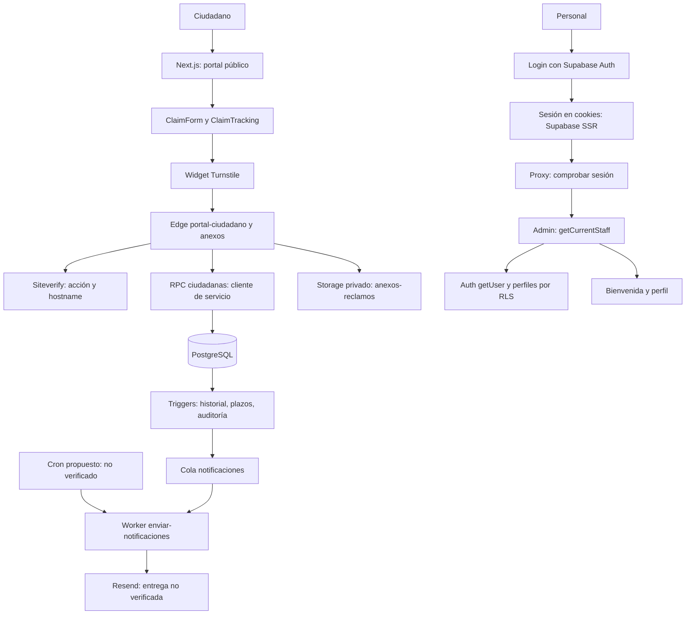

# Arquitectura

Estado observado al 05/11/2026. Backend descrito desde fuentes locales; evidencias reales en [TESTING.md](TESTING.md).

## Mapa actual



El portal usa cliente navegador compartido con auth. Sus operaciones ciudadanas pasan por Edge y allí se validan Turnstile/DNI+código mediante cliente de servicio independiente. No trasladar esa clave al servidor público de Next ni al navegador.

La sesión municipal usa `createBrowserClient`, `createServerClient`, cookies asíncronas y Proxy. `/admin` verifica usuario ante Auth, perfil activo, rol y existencia de área para responsable. Las guías de Next instaladas respaldan `src/proxy.ts` y `await cookies()`. La autorización de datos/acciones debe repetirse en RLS/RPC y capa de acceso servidor.

## Distribución física

```text
Gestion de Reclamos/
├─ plataforma-reclamos/             ← este repositorio
│  ├─ src/app/{page,layout,globals}
│  ├─ src/app/{login,admin}/page.tsx
│  ├─ src/components/{claim-*,turnstile-loader,staff-*}
│  ├─ src/components/ui/
│  ├─ src/lib/auth/{roles,staff}.ts
│  ├─ src/lib/supabase/{client,server,proxy}.ts
│  └─ src/proxy.ts
├─ supabase_reclamos/               ← SQL originales
└─ supabase_reclamos_implementation/
   ├─ sql-originales/               ← copia idéntica
   ├─ ejemplos-frontend/
   └─ supabase/{functions,migrations,sql,config.toml}
```

No hay Route Handlers Next propios, Server Actions de negocio, recuperación/callback Auth, layouts públicos/privados diferenciados ni capa de servicios ciudadanos. Las llamadas están en componentes. Las primitivas de `components/ui` no unifican todavía los formularios.

## Organización propuesta, sin implementar

Extraer gradualmente `lib/services`, `lib/types`, `lib/validation` y helpers de fecha/errores, conservando payloads. Centralizar Turnstile con timeout, renovación y limpieza. Mantener clientes navegador/servidor separados.

Toda nueva ruta privada debe comprobar sesión/perfil en servidor antes de consultar datos. Después de confirmar esquema, incorporar layouts y módulos de personal, bandeja, detalle, reportes y configuración. El matcher no reemplaza el guard de cada recurso.

No introducir otro motor de estados ni RBAC paralelo: `rpc_detalle_reclamo.acciones` orienta botones, y la RPC vuelve a validar acción/rol/área. Asignación individual y permisos granulares requieren un contrato aprobado. Orden y dependencias: [AUDIT_PHASE_0.md](AUDIT_PHASE_0.md).
