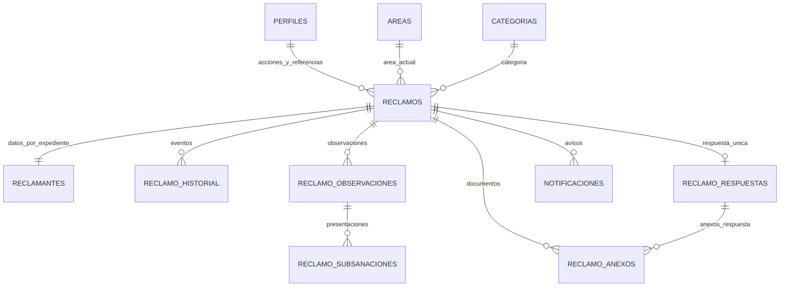

# Base de datos

Inventario del SQL **local**, no introspección del proyecto desplegado. Las verificaciones remotas se limitan a [TESTING.md](TESTING.md). No se ejecutó SQL ni se modificaron migraciones.

## Fuentes e instalación histórica

`../supabase_reclamos_implementation/sql-originales/` contiene scripts 01–14 de instalación, 15 de datos demo opcionales y 99 de reinicio destructivo. Son idénticos a `../supabase_reclamos/`. No repetirlos en una base existente. El script 15 no se ejecutó ni se usó para mostrar resultados ficticios.

Solo hay una migración local en `supabase/migrations`: `20261104_edge_hardening_sms_off.sql`. Revoca cuatro RPC ciudadanas a PUBLIC/anon/authenticated, las concede a service_role, apaga SMS, cancela SMS pendientes y reemplaza la toma de cola por correos con límite 1–50 y lease de 5 minutos. Su aplicación remota no se comprobó. Los scripts originales no constituyen un historial completo de migraciones verificadas.

`supabase/sql/17_programar_notificaciones.sql` es un script separado: Vault + pg_net + cron cada 3 min. No es una migración automática. Conserva placeholders y no prueba que exista un job activo.

## Inventario de tablas

24 tablas en `public`, una en `privado`, más dependencias de Supabase Auth/Storage:

| Grupo | Tablas | Relación/función |
|---|---|---|
| Configuración | parametros, plantillas, feriados | Parámetros JSON, textos y calendario hábil |
| Catálogos | areas, categorias, reglas_derivacion | Categoría→área; reglas con prioridad/vigencia; áreas con responsable opcional |
| Flujo | estados_reclamo, transiciones_estado | Acción/origen/destino/roles/motivo |
| Identidad | perfiles | 1:1 auth.users; rol, área, activo |
| Numeración | correlativos | Correlativo anual REC-AAAA-NNNNNN |
| Expediente | reclamos, reclamantes | Reclamante 1:1 por reclamo, no ficha única por DNI |
| Trazabilidad | reclamo_historial, reclamo_derivaciones, reclamo_reasignaciones, reclamo_actuaciones | Eventos públicos/internos, movimientos por área, solicitudes, notas |
| Observación | reclamo_observaciones, reclamo_subsanaciones | Subsanación ligada a observación; una pendiente por reclamo mediante índice único |
| Respuesta | reclamo_respuestas, reclamo_anexos | Una respuesta por reclamo; metadata de origen registro/subsanación/respuesta |
| Avisos | notificaciones, alertas_plazo | Cola/canales alternos y alerta única por reclamo/tipo |
| Control | intentos_consulta, auditoria | HMAC de identificadores y bitácora de cambios |
| Privado | privado.secretos | Secreto HMAC generado en base; sin lectura API |

`reclamos` tiene `area_id` y no un responsable individual. `subcategoria` es texto libre: no existe tabla de subcategorías. Tipo de documento es enum exclusivamente DNI. No hay tablas de permisos granulares.

Diagrama resumido: no sustituye las FK de SQL 02/03. Las referencias desde reclamos a perfiles registran actores de clasificación; no asignación individual.

## Estados y transiciones reales

15 códigos: `registrado`, `en_revision`, `observado`, `pendiente_subsanacion`, `pendiente_derivacion`, `derivado`, `en_atencion`, `pendiente_info_interna`, `en_elaboracion_respuesta`, `pendiente_aprobacion`, `respondido`, `cerrado`, `no_admitido`, `derivado_otra_entidad`, `archivado`.

| Actor | Acción y tránsito local |
|---|---|
| Mesa | revisar: registrado→en_revision; confirmar_categoria: en_revision→mismo |
| Mesa | registrar_observacion: en_revision→observado; pasar_pendiente_subsanacion: observado→pendiente_subsanacion (también sistema) |
| Ciudadano | presentar_subsanacion: observado/pendiente_subsanacion→en_revision |
| Mesa | derivar: en_revision/pendiente_derivacion→derivado; marcar_pendiente_derivacion: en_revision→pendiente_derivacion |
| Mesa/supervisor | declarar_improcedente o derivar_otra_entidad desde en_revision |
| Responsable | iniciar_atencion: derivado→en_atencion; solicitar_reasignacion: derivado/en_atencion→mismo |
| Responsable | solicitar_info_interna: en_atencion→pendiente_info_interna; retomar_atencion: inversa |
| Responsable | elaborar_respuesta: en_atencion→en_elaboracion_respuesta; enviar_aprobacion: ambos→pendiente_aprobacion |
| Supervisor | devolver_respuesta: pendiente_aprobacion→en_elaboracion_respuesta; aprobar_respuesta: pendiente_aprobacion→respondido |
| Supervisor | cerrar: respondido→cerrado; archivar: cerrado/no_admitido/derivado_otra_entidad→archivado |
| Mesa/supervisor | aprobar_reasignacion mediante RPC específica: derivado/en_atencion→pendiente_derivacion y área Mesa |

Rechazar reasignación conserva estado. No existe reapertura ni estado independiente “subsanado” o “atendido”. El público agrupa varios estados internos bajo En atención/Observado/En revisión. El motivo obligatorio se toma de `transiciones_estado.requiere_motivo`, no de supuestos de UI.

## Reglas y cálculos

- Día institucional: `privado.hoy()` en America/Lima. Días hábiles: lunes–viernes excluyendo `feriados`. El día inicial no cuenta; intervalo `(desde, hasta]`.
- Plazo base: parámetro local de 15 días hábiles; observación 10. Son valores semilla, no afirmación de plazo legal ni validación municipal.
- Observado/pendiente_subsanacion suspenden plazo; salida prolonga vencimiento por días hábiles suspendidos. Derivar no reinicia plazo. Fecha de registro, código, plazo y categoría declarada son inmutables.
- Cierre exige respuesta `notificada`; aprobación crea `aprobada` y encola aviso. Éxito del aviso o registro manual alterno la marca notificada; envío no significa lectura.
- Promedio de atención: media de días hábiles registro→fecha_respuesta para expedientes que la tengan, redondeada a 1 decimal; **no resta suspensión**. No es tiempo hasta lectura/cierre.
- Cumplimiento: 100×respondidos con fecha_respuesta local ≤ fecha_vencimiento / total con fecha_respuesta. Denominador cero devuelve null.
- Indicadores filtrados por fecha de registro y área actual, no por fecha de respuesta ni área histórica. `en_atencion` cuenta ese código exacto; `observados` agrupa dos códigos; próximos/vencidos excluyen plazos suspendidos/inactivos.
- Subsanación verifica observación pendiente y plazo no vencido. El job marca vencida y no cambia automáticamente el estado del reclamo.
- Anexos: trigger cuenta por reclamo+origen, no por cada subsanación. SQL/Edge/Storage deben coincidir en tamaños y formatos antes de configurar otros límites.

## Vistas, índices y seguridad

`v_bandeja_reclamos` y `v_plazos` son SECURITY INVOKER; bandeja admite filtros, `.order()` y `.range()`. Índices por estado, área+estado, categoría, registro, vencimiento, DNI y GIN trigram de código/asunto; historial y otras tablas tienen índices de expediente. No se ejecutó EXPLAIN ni evaluación de rendimiento remoto.

RLS local activo en tablas; lectura por rol/área, escritura de expediente mediante RPC SECURITY DEFINER. Auditoría/historial rechazan UPDATE/DELETE/TRUNCATE por trigger. Revisar H01 y H02 antes de certificar aislamiento. Bucket `anexos-reclamos`: privado, 5 MiB, PDF/JPEG/PNG según SQL 13; configuración efectiva sin verificar.
